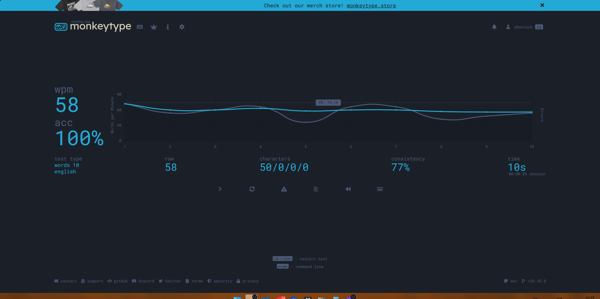

# ⌘ KeyFlow

> **Minimalist hotkey & muscle memory trainer for power users.**  
> Inspired by the distraction-free aesthetics and philosophy of Monkeytype, built specifically for mastering professional software keyboard shortcuts.



---

## ✨ Features

- **⚡ Professional Software Packs**: Built-in curated shortcut packs for **VS Code**, **Figma**, **Blender 3D**, and **Excel / Sheets**.
- **🔥 Firebase Authentication & Real Cloud Persistence**:
  - Email & Password registration & login.
  - One-click Google and GitHub OAuth sign-in (`signInWithPopup`).
  - Real-time profile state sync via Firestore `onSnapshot`.
- **🏷️ Customizable Database Badges**:
  - User documents include a `badge` field in Firestore (empty by default).
  - Can be edited directly via the Firebase Console (e.g. `"🚀 Mythical"`, `"🔥 Grandmaster"`).
  - Automatically renders as a sleek inline pill badge in the profile and global leaderboards.
- **🏆 Global Leaderboards**:
  - Live Firestore rankings with filtering (`Time 15`, `Time 60`, `10 Keys`, `25 Keys`, `All Packs`).
  - Columns: `#`, `name` with badges, `wpm / spm`, `accuracy`, `raw`, `consistency`, and `date`.
- **🎨 7 Themed Palettes**: Obsidian Minimal, Dracula, Nord Frost, Cyberpunk, Retro Beige, Matcha Moss, and Matrix Phosphor.
- **🔊 Procedural Switch Audio**: Zero external audio assets. Real-time procedural mechanical keyboard switch synthesis via the Web Audio API (Clicky Blue, Tactile Brown, Linear Red, or Silent).
- **📊 Monkeytype-Style Scorecard Export**:
  - Copies an image scorecard directly to the system clipboard as PNG (`ClipboardItem`).
  - Displays the card in an overlay for 3 seconds before auto-closing.
  - Interactive SVG performance graph (Speed SPM, Reaction ms, and combined views).
- **⌨️ Robust Chord Interception Engine**:
  - Dual-phase capture (`window` + `document`) preventing browser default actions (`Ctrl+P`, `Ctrl+S`, `Ctrl+D`, `Shift+Alt+Down`).
  - Automatic OS detection (`Cmd ⌘` / `Option ⌥` on macOS vs. `Ctrl` / `Alt` / `Win ⊞` on Windows/Linux).
  - Physical keycode resolution (handles shifted characters like `Shift + [` resulting in `{` correctly).
  - Fullscreen Focus Mode with `navigator.keyboard.lock()` support.
- **⏱️ Monotonic Continuous Timer**:
  - Timer starts the exact moment you press your first key and runs non-stop without stuttering or resetting on keystrokes.

---

## 🔑 Firebase Setup & GitHub Repository Secrets Guide

KeyFlow supports zero-config local run with pre-bundled `firebase-applet-config.json`, and seamlessly reads Vite environment variables (`VITE_FIREBASE_*`) for GitHub repository exports and CI/CD deployments.

### 1. What to get from the Firebase Console
1. Go to the [Firebase Console](https://console.firebase.google.com/).
2. Create or open your project.
3. In **Project settings** (gear icon ⚙️ at top left) -> **General**:
   - Scroll down to **Your apps**.
   - Select your Web App (or click `</>` to create a Web app: e.g. "KeyFlow Web").
   - You will see the `firebaseConfig` object:
     ```javascript
     const firebaseConfig = {
       apiKey: "AIzaSy...",
       authDomain: "your-project.firebaseapp.com",
       projectId: "your-project",
       storageBucket: "your-project.firebasestorage.app",
       messagingSenderId: "1234567890",
       appId: "1:1234567890:web:abcdef..."
     };
     ```
4. In **Build -> Authentication**:
   - Click **Sign-in method** and enable:
     - **Email/Password**
     - **Google**
     - **GitHub** (requires Client ID & Secret from GitHub Developer Settings)
5. In **Build -> Firestore Database**:
   - Create database in production mode.
   - Deploy the rules provided in `firestore.rules`.

### 2. Where to put them in GitHub Repository Secrets
If you are deploying KeyFlow using GitHub Actions (e.g. to GitHub Pages, Cloudflare Pages, or Vercel):
1. Open your GitHub Repository.
2. Go to **Settings** -> **Secrets and variables** -> **Actions**.
3. Under **Repository secrets**, click **New repository secret** and add:
   - `VITE_FIREBASE_API_KEY`: Value from `apiKey`
   - `VITE_FIREBASE_AUTH_DOMAIN`: Value from `authDomain`
   - `VITE_FIREBASE_PROJECT_ID`: Value from `projectId`
   - `VITE_FIREBASE_STORAGE_BUCKET`: Value from `storageBucket`
   - `VITE_FIREBASE_MESSAGING_SENDER_ID`: Value from `messagingSenderId`
   - `VITE_FIREBASE_APP_ID`: Value from `appId`
   - `VITE_FIREBASE_DATABASE_ID`: Optional (e.g. `(default)`)

Or create a local `.env` file from `.env.example`:
```bash
cp .env.example .env
```

---

## 🏷️ How to Edit User Badges in Firestore
Every user document is stored in the collection `users/{userId}`:
1. Open [Firebase Console -> Firestore Database](https://console.firebase.google.com/).
2. Click on the `users` collection.
3. Select any user document.
4. Add or edit the field `badge` (type: `string`):
   - Example: `🚀 Mythical`
   - Example: `🔥 Grandmaster`
   - Example: `⚡ Speed Demon`
5. Click **Save**. The badge will immediately appear in the user's profile, top navigation, and on the leaderboard next to their scores!

---

## 📁 Project Architecture & Codebase Map

For developers customizing or extending KeyFlow, here is where everything is located:

```
├── src/
│   ├── data/
│   │   ├── presets.ts      👈 [SHORTCUTS LIST] All software hotkey packs live here!
│   │   └── themes.ts       👈 [THEMES LIST] All color themes & palettes live here!
│   │
│   ├── lib/
│   │   └── firebase.ts     👈 Firebase app, auth, and firestore singleton & error handlers
│   │
│   ├── utils/
│   │   ├── engine.ts       👈 Core keyboard engine & chord matcher
│   │   ├── auth.ts         👈 Real Firebase Auth, Firestore stats sync & leaderboard query
│   │   ├── cardGenerator.ts👈 Monkeytype-style 2x Retina PNG scorecard generator
│   │   ├── audio.ts        👈 Web Audio API procedural mechanical switch synthesizer
│   │   └── storage.ts      👈 Sanitized LocalStorage manager (settings & history)
│   │
│   ├── components/
│   │   ├── Navbar.tsx           👈 Top bar (pack picker, timer/keys/zen, crown, profile button)
│   │   ├── ActivePrompt.tsx     👈 Central card displaying the target shortcut & keycaps
│   │   ├── ChordVisualizer.tsx  👈 Real-time live HUD showing physically held modifier keys
│   │   ├── ResultsView.tsx      👈 Post-test screen with performance graph & scorecard
│   │   ├── AuthModal.tsx        👈 Monkeytype dual-panel Register & Sign-in modal
│   │   ├── AccountModal.tsx     👈 Profile modal (avatar, badge, XP level, bio, keyboard, heatmap, PBs)
│   │   ├── LeaderboardModal.tsx 👈 Live global Firestore rankings with filters & badges
│   │   ├── CheatsheetModal.tsx  👈 In-app searchable shortcut reference
│   │   ├── HistoryModal.tsx     👈 Personal bests & previous sessions history
│   │   └── SettingsModal.tsx    👈 Theme selector, sound profile, and volume controls
│   │
│   ├── types/
│   │   └── index.ts        👈 TypeScript definitions (ShortcutDefinition, SessionResult, UserProfile, LeaderboardEntry)
│   ├── App.tsx             👈 Main state orchestrator & dual-level keyboard event listener
│   └── main.tsx            👈 React entry point
├── firestore.rules         👈 Zero-trust ABAC Firestore security rules
└── firebase-blueprint.json 👈 Intermediate representation schema
```

---

## 🚀 Getting Started

### Prerequisites
- Node.js 18+ or Bun
- npm, pnpm, or bun

### Local Development
```bash
# 1. Clone the repository
git clone https://github.com/your-username/keyflow.git
cd keyflow

# 2. Install dependencies
npm install

# 3. Start development server
npm run dev
```

Open [http://localhost:3000](http://localhost:3000) in your browser.

### Building for Production
```bash
# Build production bundle
npm run build

# Preview production build locally
npm run preview
```
The output directory will be `dist/`, containing pure static HTML/CSS/JS ready to deploy to GitHub Pages, Cloudflare Pages, Vercel, or Netlify.

---

## 🎮 Game Controls & Hotkeys

| Shortcut | Action |
| :--- | :--- |
| `Tab + Enter` | Quick restart test |
| `Esc` | Reset to start / Close open modals |
| `?` | Open shortcut cheatsheet |
| Click `⌘ keyflow` logo | Instantly return to active trainer |

---

## 📄 License
MIT License. Free and open source for everyone.
